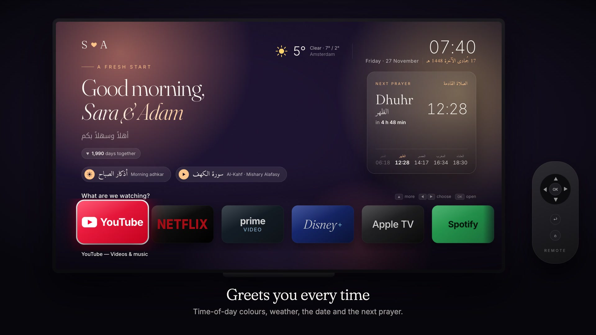
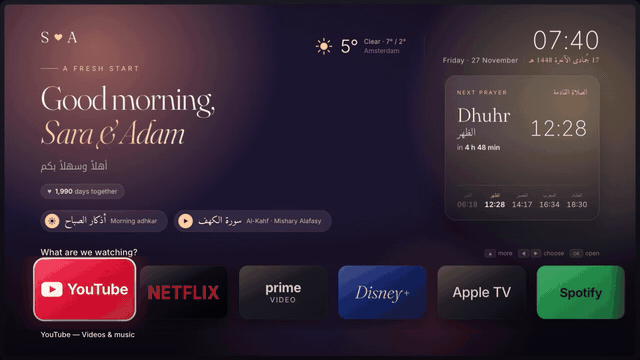
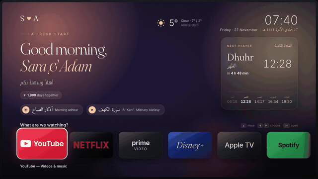
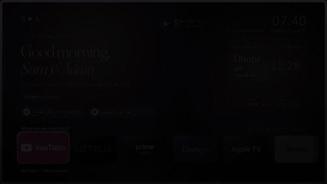
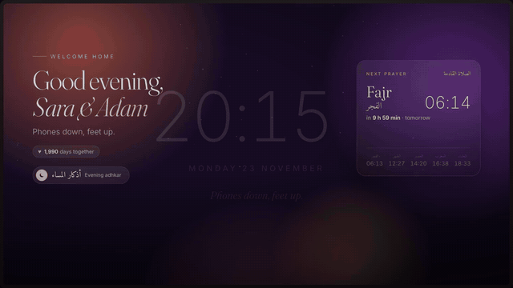
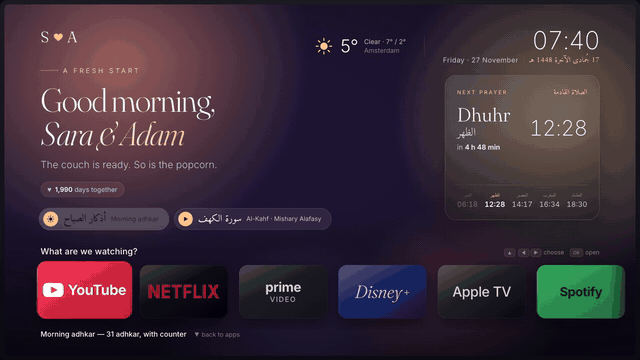
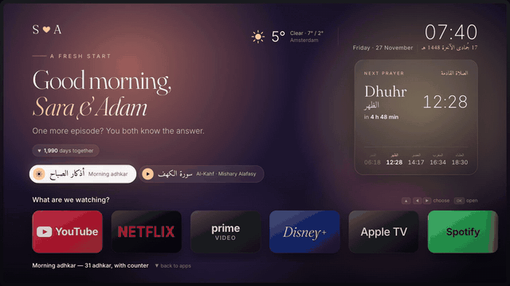
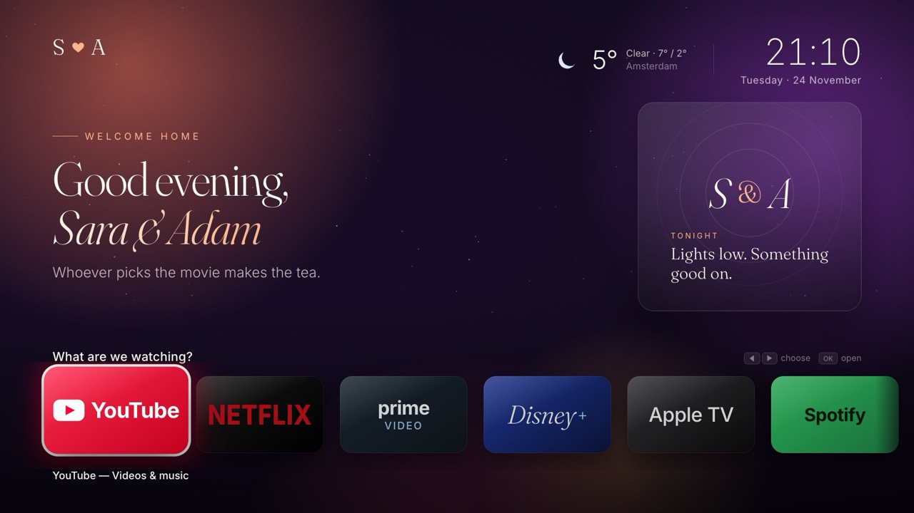
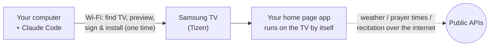

<div align="center">

# samsung-tv-home

**A personal home screen for your Samsung smart TV — designed, built and installed by Claude from your computer.**

Greets you by name · your apps in big tiles · weather & time-of-day colours · ambient clock<br>
Optional: next prayer & Hijri date · morning/evening adhkar · Surat Al-Kahf on Fridays




▶️ **[Watch the 55-second demo](media/demo.mp4)**

</div>

---

## What it is

A [Claude Code](https://docs.claude.com/en/docs/claude-code) **skill**. Install it, then tell Claude something like *"make a welcome page for our Samsung TV"*. Claude finds the TV on your Wi-Fi, personalises the page with you, previews it on your computer, walks you through Samsung's one-time developer setup, and installs it on the TV.

The page is a real TV app, signed with **your own Samsung certificate**. Once it's installed, the TV runs it on its own: your computer is only needed to change things and reinstall.

## Features

<table>
<tr>
<td width="50%"><br><b>Greets you every time.</b> Your names, the time, the date and the weather, with colours that follow the day: warm in the morning, violet in the evening, starry at night.</td>
<td width="50%"><br><b>Your apps, nothing else.</b> Big tiles for YouTube, Netflix, Prime Video, Disney+ and more. Tiles for apps that aren't on the TV hide themselves. It remembers the last app you used.</td>
</tr>
<tr>
<td><br><b>Changes with the day.</b> The greeting, the colours and the little rotating note all follow the time of day, and weekends say hello too.</td>
<td><br><b>Ambient clock.</b> After a few idle minutes the page fades to a large, slowly drifting clock. Any button brings it back.</td>
</tr>
</table>

### Optional Muslim features

<table>
<tr>
<td width="50%"><br><b>Morning &amp; evening adhkar.</b> <i>أذكار الصباح</i> from Fajr and <i>أذكار المساء</i> from Asr. Opens a full-screen reader in a proper Arabic typeface. <kbd>OK</kbd> counts the repetitions and moves on by itself.</td>
<td width="50%"><br><b>Surat Al-Kahf on Fridays.</b> Starts by itself the first time you open the page on a Friday, shows progress and remembers where you stopped.</td>
</tr>
</table>

The right-hand card shows the **next prayer with a countdown**, today's five times and the **Hijri date**, and a gentle banner appears when a prayer time arrives. Times come from [Aladhan](https://aladhan.com) for your city, and you can match them to your mosque's calculation method or adjust them minute by minute.

**Without these features** the card shows your monogram and a line for the moment:



## How it works



1. **Find the TV.** It's discovered on your network, even with a VPN on, and Claude checks which apps it has.
2. **Personalise.** Names, city, apps and features go in one config file. You see a live preview in your browser first, with the arrow keys acting as the remote.
3. **One-time setup.** Samsung's Tizen tools (download in the background), *Developer Mode* on the TV (about 2 minutes with the remote) and a free Samsung certificate (about 5 minutes; you sign in to your Samsung account yourself).
4. **Install.** One command signs the app and installs it over Wi-Fi.
5. **Pin it** first in the TV's home bar, so **Home → OK** always opens it.

## Install the skill

```bash
git clone https://github.com/amine0110/samsung-tv-home.git ~/.claude/skills/samsung-tv-home
```

Then, in Claude Code:

> *"Make a welcome page for our Samsung TV. It's for me and Sara, we mostly watch YouTube and Netflix."*

**You need:**
- A Samsung smart TV running Tizen (2017 or later). Tested on a 2020 TU7020.
- A Mac or Linux computer on the same Wi-Fi. On Windows the scripts need small changes.
- A free Samsung account.
- About 1.3 GB of disk space for Samsung's tools.

## Good to know (tested, not guessed)

- **The TV won't open the page by itself at power-on, and the Home button can't be redirected.** Samsung reserves both for its own apps. Sideloaded apps are also closed when the TV goes to standby; we tried a background "come back to the front" trick and logged it failing. What works: pin the app first in the home bar, and if the TV is turned off while the page is showing, it comes back on the page.
- **The TV's browser is old** (Chromium 69 on 2020 models). The template avoids what it can't render, such as flex `gap`, `inset` and remote web fonts. Read [`references/tizen-notes.md`](references/tizen-notes.md) before adding your own CSS.
- **Developer connection:** the TV refuses it for a minute or two after power-on. `deploy.sh` retries on its own.

## Use it without Claude

Everything is plain scripts:

```bash
python3 scripts/find_tv.py                                   # find the TV
python3 scripts/tv.py <tv-ip> apps                           # which apps are installed
python3 scripts/new_project.py ~/tv-home --tv-ip <tv-ip>     # create your project
$EDITOR ~/tv-home/app/config.js                              # names, city, apps, features
python3 scripts/fetch_assets.py ~/tv-home/app --adhkar       # fonts (+ adhkar text)
python3 -m http.server 8811 --directory ~/tv-home/app        # preview at localhost:8811
bash scripts/install_tizen_cli.sh                            # Samsung tools (slow, run once)
~/tv-home/deploy.sh                                          # sign, install, open on the TV
```

Step-by-step TV and certificate setup: [`references/tv-setup.md`](references/tv-setup.md). All the config options: [`references/customize.md`](references/customize.md).

## Repository layout

| Path | What it is |
|---|---|
| `SKILL.md` | Instructions Claude follows |
| `assets/app/` | The TV app template (HTML/CSS/JS, 1920×1080, remote-control navigation) |
| `scripts/` | Find the TV, talk to it, create a project, fetch assets, install Tizen tools, deploy, receive logs |
| `references/` | TV setup, customisation, Tizen pitfalls & troubleshooting |
| `tools/demo/` | How the demo video and GIFs were recorded |
| `media/` | Demo video, GIFs and screenshots |

## Privacy

Everything stays between your computer and your TV. The app itself only calls public services: [Open-Meteo](https://open-meteo.com) for the weather, [Aladhan](https://aladhan.com) for prayer times and [mp3quran.net](https://mp3quran.net) for the recitation. Your names and settings live in your own project folder, not in this repository.

## Credits & licences

- Code: [MIT](LICENSE).
- Fonts: Fraunces, Inter, Noto Kufi Arabic and Amiri from Google Fonts, under the SIL Open Font License. `fetch_assets.py` downloads them into your project.
- Adhkar text: Hisn al-Muslim, from [osamayy/azkar-db](https://github.com/osamayy/azkar-db). That dataset has no licence file, so it's downloaded on your machine, not redistributed here.
- Recitation: Mishary Alafasy via mp3quran.net, streamed and not stored.
- App tiles use typographic wordmarks, not official logos. Samsung, Tizen and the app names are trademarks of their owners. This project is not affiliated with Samsung.
